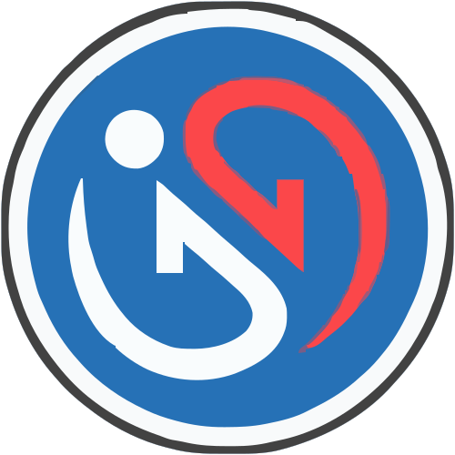

# Aset Logo IGOS Nusantara

  

Repositori resmi untuk aset logo dan ikon visual [IGOS Nusantara (IGN)](https://igos-nusantara.or.id/), sistem operasi sumber terbuka yang dikembangkan bersama komunitas sejak 2006. Repositori ini didedikasikan untuk pengelolaan dan penyediaan berkas aset grafis resmi.

## Struktur dan Varian Berkas

Semua berkas logo berada pada direktori `logo/` dengan konvensi penamaan `[ukuran]-[varian].[format]`.

### Varian Logo

| Varian | Peruntukan |
|---|---|
| `large*` | Kebutuhan resolusi tinggi (cetak, banner, media fisik) |
| `small*` | Kebutuhan digital (web, antarmuka aplikasi, dokumen) |
| `*transparent*` | Latar transparan (cocok untuk latar belakang gelap atau berwarna) |
| `*no-border*` | Tanpa garis bingkai lingkaran luar |

Varian dapat dikombinasikan. Sebagai contoh, `large-no-border-transparent.png` adalah varian berukuran besar, tanpa bingkai lingkaran luar, dengan latar transparan. Format berkas yang tersedia meliputi JPEG, PNG, dan SVG.

### Ikon Sistem Desktop (freedesktop.org)

Direktori `logo/icons/hicolor/` menyediakan kumpulan ikon yang mengikuti spesifikasi [freedesktop.org Icon Theme](https://specifications.freedesktop.org/icon-theme-spec/latest/):

- Ukuran bitmap: `hicolor/<ukuran>/apps/ign.png` (mulai dari 16×16 hingga 1024×1024 piksel).
- Vektor terukur: `hicolor/scalable/apps/ign.svg`.

Kumpulan berkas ini disiapkan untuk dipasang pada direktori sistem `/usr/share/icons/hicolor/` agar ikon aplikasi IGOS Nusantara dapat dikenali dan ditampilkan secara tepat oleh lingkungan desktop Linux.

## Panduan Penggunaan

1. **Pilih Varian**: Sesuaikan resolusi dan varian grafis berdasarkan media target (cetak atau digital).
2. **Atribusi**: Berikan atribusi sesuai ketentuan lisensi CC BY-SA 4.0:

   > Logo IGOS Nusantara, © Proyek IGOS Nusantara — [CC BY-SA 4.0](https://creativecommons.org/licenses/by-sa/4.0/)

## Lisensi dan Merek Dagang

- **Lisensi Konten Grafis**: Seluruh berkas grafis dalam repositori ini dilisensikan di bawah [Creative Commons Attribution-ShareAlike 4.0 International (CC BY-SA 4.0)](LICENSE).
- **Kebijakan Merek Dagang**: Nama "IGOS Nusantara", singkatan "IGN", dan logo terkait merupakan merek dagang dari Proyek IGOS Nusantara. Lisensi hak cipta (CC BY-SA 4.0) tidak mencakup hak merek dagang. Penggunaan nama dan logo diatur secara terpisah dalam [TRADEMARK.md](TRADEMARK.md).

## Kontribusi

Untuk usulan varian baru, perbaikan berkas, atau pembaruan aset lainnya, silakan ajukan *issue* atau kirimkan *pull request* pada repositori ini.
